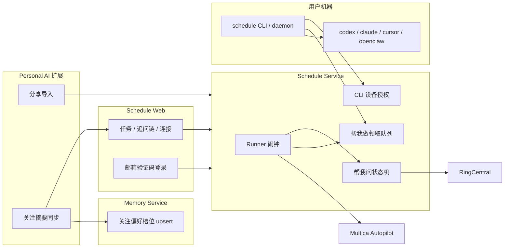

# Schedule 剥离 Memory、本机 Worker CLI、扩展职责重划

状态：实施中（§8.3 第 1–2 步已部署；第 3 步切片：本地 outreach 会话 + rc_user；第 4 步切片：worker 队列 + CLI claim/report + 轮询收尾）。来源：E-194 线程 2026-11-09 产品决定。取代 `docs/plan-b-execution-boundary-spec.md` 中「业务链路唯一归 memory-service」「帮我做默认走 memory 执行器栈」两条边界；时间源仍唯一归 Schedule Runner。

实现卡片（均 backlog，未开工）：Schedule 仓 [E-200](mention://issue/01a1c0c5-36d4-7c33-895e-e57b2f876f37)；Personal AI 仓 [E-201](mention://issue/01a1c0c5-382f-766d-9027-5f4d58787223)。本文是实现依据。Personal AI 侧操作清单见第 8 节。

## 0. 产品决定（已锁定）

1. **Schedule 网页不再连接 Memory Service。** 帮我问 / 帮我做不再把 `pak` 当必备配置。连接页去掉 Memory 卡片。
2. **帮我问（含追问）整条搬进 Schedule。** 发帖、轮询回复、分类、追问、结案用 **AsMe（`rc_user`）**，与 As me 任务共用同一套 RingCentral JWT，不另配 Memory RC。
3. **帮我做只走两条执行器：** Multica Autopilot webhook，或 Schedule 自己的 **本机 Worker CLI**（模仿 Multica daemon：下载、登录、常驻、领取任务、调本地 Codex / Claude Code / Cursor / OpenClaw）。不再经 memory-service 执行器注册表。
4. **扩展不再做自动登录。** 网页登录只保留邮箱验证码；单设备数据合并（E-194）保留。扩展最重要的产品功能是 **分享包导入**；其次是把页面上值得沉淀的关注信号 **静默同步进 Memory Service**（用扩展里已有的 Memory 配置，Schedule 侧零配置）。
5. **Glip 上的即时帮我问** 仍是 Personal AI / Memory 的产品，不在本次搬迁范围。计划帮我问（Schedule）与即时帮我问（Glip）允许两套引擎并存。

## 1. 目标架构



单一 owner：

| 事实 | Owner |
|---|---|
| 何时该发生 | Schedule Runner（不变） |
| 帮我问会话 / 追问 / 结案 | **Schedule Service**（新） |
| 帮我做排队 / 租约 / 结果回写 | **Schedule Service**（新，替代 memory `/agent-tasks`） |
| 本地模型执行 | **schedule CLI** 调本机 ACP / OpenClaw |
| Multica 执行 | Runner 直打 webhook（已有） |
| As me / Bot / AI Report / JIRA / Timeline | Schedule Runner（已有，不经 Memory） |
| 网页身份 | 邮箱验证码 + 访客合并（已有） |
| CLI 身份 | 邮箱验证码，或网页已登录后的设备授权（新） |
| 分享导入 | 扩展（cookie 会话，不持 PAT） |
| 关注偏好记忆 | 扩展 → Memory（upsert，不是流水账） |

## 2. 从 Schedule 删掉什么

现网 Memory 耦合点（实现时按此清单清干净）：

| 位置 | 现状 | 处理后 |
|---|---|---|
| 连接 `memory`（`baseUrl` + `userKey`） | 用户必填 | **删除**连接类型、UI 卡片、校验 |
| `store.js` `connection:memory` | outreach / 默认 agent_task 的 missing | outreach → `connection:rc_user`；agent_task → `multica` 或 `worker` |
| `providers.outreach` | POST memory `trigger-occurrence` | 改为本地创建会话 + 入队推进 |
| `providers.agent_task` `executor:'memory'` | POST `/agent-tasks/execute` | 删除该分支 |
| `runner.js` 轮询 memory `runs/:id/result` | 默认帮我做收尾 | 改为 worker `report` 或 Multica 回读 |
| `GET /tasks/:id/chain` 及 cancel/continue/retry 代理 | 转发 memory | 改读本地 `outreach_sessions` |
| `/api/v1/meta` executor `memory` | 对外声明 | 改为 `multica` / `worker` |
| 创建流默认执行器 | Memory Service | 本机 Worker（无 worker 在线则提示下载 CLI）或已配置的 Multica |
| `docs/schedule-service-api-contract.md` outreach 所需连接 | `memory` | `rc_user` |
| 测试夹具 mock memory HTTP | `exactRun.test.js` 等 | 改为本地队列 / worker 协议 |

**不删：** 邮箱登录、访客合并、AsMe/Bot/AI Report/JIRA/Timeline、Multica webhook、分享 API、扩展 presence 通道 `personal-schedule-extension-v1`（仍用于「已安装」检测与分享导入）。

## 3. 帮我问搬进 Schedule

### 3.1 凭据

- 发送身份 = 连接 **RingCentral 个人授权（`rc_user`）**，与 As me 共用。
- 缺 `rc_user` → 任务 `inactive`，补全文案「帮我问用你的 As me 身份发送和追问」。
- 不引入第二套 RC JWT，不读 Memory 的 `RINGCENTRAL_JWT`。
- 目录搜人继续用已有规则：已验证 `rc_user` 优先，否则部署级全局目录 JWT（E-197）。发帖仍必须是用户自己的 `rc_user`。
- v1 不支持 Bot 身份帮我问（追问要用同一身份读帖；Bot 轮询会话权限与 AsMe 不同）。若以后要 Bot，另开任务。

### 3.2 状态机（从 OutreachEngine 迁语义，不迁 Memory 库）

沿用已核验的状态，存 Schedule SQLite：

```
pending_approval → scheduled → waiting_reply ⇄ deferred
                         ├→ followup_sent → waiting_reply
                         ├→ resolved | no_reply | escalated | failed | cancelled
```

occurrence 幂等键不变：`templateId` = 任务 id，`occurrenceKey` = Runner 的 `occ_key`。同一键只建一条会话。

Runner 到期职责：**只创建会话**（若需审批则 `pending_approval`，否则 `scheduled` 并立即 dispatch 首问）。之后推进不靠「再响一次闹钟」，而靠 Schedule 进程内的 **outreach loop**（现 Runner 旁边的 `setInterval`，浏览器关闭不影响）。

会话推进（每 30–60s，可配置）：

1. `scheduled` → 用 `rc_user` 发首问（复用 `rcPostMessage`）。
2. `waiting_reply` / `deferred` → `listPosts(chatId, since lastPollAt)`，排除自己的帖，按 postId 去重。
3. 有回复 → 分类（见 3.3）→ `resolved` / `deferred`（等到 eta）/ 忽略无关 / `escalated`。
4. 无回复且 `now >= waitUntil`：`followupCount < maxFollowup` 则发追问并 +1，否则 `no_reply`。
5. RC 凭据失效 → `failed` + `missing_config`，任务 `needs_attention`，可重试。

详情页「追问链」读本地 sessions/events，不再跨服务。操作 `cancel` / `continue-followup` / `retry` / `increase-followup-limit` 落在 Schedule。

### 3.3 回复分类用的 LLM（不是 Memory 连接）

现网分类与追问措辞走 Memory 的 `LLMClient`。搬过来之后 **Schedule 需要一个部署级 LLM**，对用户不可见、不出现在「连接与执行器」：

环境变量（示例）：`SCHEDULE_LLM_BASE_URL` / `SCHEDULE_LLM_API_KEY` / `SCHEDULE_LLM_MODEL`。

用途仅限：`answer | defer | irrelevant | decline | unclear`，以及生成下一句追问（语气保持「我」）。凭证不进 prompt。未配置 LLM 时的降级：无回复按时间追问；有回复且非空则视为 `answer` 并结案（宁可少追问，不误追）。

这是剥离后唯一还留在 Schedule 里的「模型依赖」，它不是 Memory，也不要求用户配 `pak`。

### 3.4 明确不搬的 Memory 能力

以下留在 Personal AI，计划帮我问 v1 **不做**：

- 用记忆库做「答案预检 / 我们是不是已经知道」
- 回复派生 `delegate_openclaw` / 自动开一条帮我做
- Glip 消息上点「帮我问」的即时会话（`from-message`）

计划帮我问 = 闹钟 + 发问 + 追问。记忆与即时入口仍是扩展 / Memory 的事。

### 3.5 存量任务

不把 Memory 里进行中的 outreach session 迁过来（状态机宿主已换，双写更脏）。

- 仍指向 `memoryTemplateId` / `executor:'memory'` 的任务：打开即 `needs_attention`，说明「Memory 路径已移除，请改用 As me 后重新启用；进行中的旧会话不会自动接续」。
- 不保留「无 Memory 则 inactive」这条 missing。启用条件只看 `rc_user` + 问题 + 收件人。

## 4. 帮我做：Multica + Schedule Worker CLI

### 4.1 执行器枚举

`config.executor` 只允许：

- `multica` — 已有 webhook；缺 webhook/binding → missing `multica.*`
- `worker` — 入队，等本机（或任意已登录的）CLI claim

删除 `memory`。创建流：已配 Multica 则可选用；默认推荐 Worker。两者都没有 → 任务可保存为 `inactive`，连接页同时给出「配置 Multica」和「下载 CLI」。

运行通知 / 发布产出：**一律由 Schedule 投递**（现网 Multica 路径已如此；Memory 路径的「Memory 代发回执」删除）。Worker 只回结构化结果：`status` / `summary_for_owner` / `final_output` / `publish_fields` / `attachments`。字段校验失败 → `publish_paused`，不把日志当正文（现契约保留）。

### 4.2 CLI 形态（模仿 Multica daemon）

仓库位置：`service/cli/`（或独立 `cli/`），随 Schedule 发布。连接页提供下载（GitHub release 或 `GET /cli/install.sh`）。

建议命令名：`schedule`（若撞名则 `pschedule`）。

```
schedule login                 邮箱验证码 → 写入 ~/.personal-schedule/credentials
schedule login --device        设备授权（网页已登录时一键，见 4.3）
schedule whoami
schedule worker start          前台领取循环
schedule worker install        安装 launchd / systemd 常驻（类 daemon）
schedule worker status
schedule worker stop
```

登录成功后的凭据是 **Schedule PAT**（`pst_*`），存在用户主目录，不进网页 JS。这是 CLI 的身份，**不是**扩展自动登录。

Worker 向 Schedule 注册：

```
POST /api/v1/workers/register     Bearer PAT → { workerId, hostname, capabilities[] }
POST /api/v1/workers/:id/heartbeat
POST /api/v1/workers/:id/claim    → 一条到期帮我做（租约 + fence）
POST /api/v1/workers/:id/report   { runId, status, summaryForOwner, finalOutput, publishFields, attachments }
```

协议语义对齐 Personal AI `worker/`（pair/heartbeat/claim/lease/report），但 **服务端是 Schedule，不是 memory-service**。不要复用 Memory 的 pairing token。

领取匹配：任务 `config.localExecutor`（`acp-codex` | `acp-claude` | `acp-cursor` | `openclaw`）∈ worker `capabilities`。未指定则 worker 用自己的默认执行器。

本机发现（启动时扫 PATH / 常见安装位置，可在 `~/.personal-schedule/worker.json` 覆盖）：

| capability | 默认调用 |
|---|---|
| `acp-codex` | `codex` ACP stdio |
| `acp-claude` | `claude` ACP |
| `acp-cursor` | `cursor-agent` ACP |
| `openclaw` | 本机 `openclaw` gateway（用户机器上的那一个，包括 10.32.35.26 上跑 worker 去打本地 gateway） |

远程 OpenClaw（例如 Mac mini）的正确形态：**在那台机器上安装并登录 CLI**，不是在 Schedule 网页再填一条 OpenClaw URL。这与 Multica daemon 跑在用户机器上同一模型。

### 4.3 CLI 登录：邮箱，或网页一键授权

两条并列，都不是扩展自动登录。

**邮箱验证码（CLI）：** 调现有 `POST /auth/email/request` + `/auth/email/verify`。验证成功后服务端为该用户 `issueToken(label=hostname)`，CLI 保存 PAT。无网页会话、无扩展。

**网页已登录 → 一键授权（推荐日常）：** GitHub device flow，页面必须已经是邮箱登录后的真实账号（访客不能授权）。

1. CLI `POST /api/v1/auth/device/start` → `{ deviceCode, userCode, verifyUrl, interval, expiresIn }`。`verifyUrl` 形如 `http://schedule.xmnup.com/app#/device?code=ABCD-23`。
2. CLI 打印「打开上面的地址，在已登录的网页点授权」；若能打开浏览器则自动打开。
3. 网页 `#/device`：未登录先走邮箱验证码（合并访客数据），已登录展示 userCode 与 CLI 主机名 → 「授权」。
4. `POST /api/v1/auth/device/approve { userCode }`（cookie 会话）签发 PAT。
5. CLI 轮询 `POST /api/v1/auth/device/poll { deviceCode }` 直到拿到 PAT。

扩展 **不参与** 此流程。可在连接页放「授权本机 CLI」入口（同一 `#/device`）。

授权页与邮箱登录一样走 E-194 合并：若当前是单设备访客，先验证邮箱、合并，再发 PAT。

## 5. 剥离后还剩哪些「不干净」——以及怎么处理

目标是 Schedule **用户可见配置里不再出现 Memory**。下面是做完第 2–4 节之后仍存在的边，能剥的剥掉，不能剥的写成明确产品边界。

| 残留 | 是否还要 Memory 连接 | 处理 |
|---|---|---|
| Glip 即时帮我问 | 否（那是扩展 / Memory 自己的功能） | **不搬。** 文档写清：计划问句在 Schedule，消息上点问在 Personal AI |
| 回复分类 LLM | 否 | 部署级 `SCHEDULE_LLM_*`，用户无感知 |
| 关注偏好写入 Memory | 否 | 扩展用自己的 `MEMORY_SERVICE_*`，见第 7 节 |
| JIRA 托管转换 | 否 | 仍要扩展（JIRA 页 cookie），与 Memory 无关 |
| 网站「登录令牌」里手动建 PAT | 否 | 留给 CLI / API，不给扩展做自动登录 |
| 存量 `executor:'memory'` 任务 | 否 | `needs_attention`，人改执行器后启用 |
| Personal AI 扩展 Options 里的 Memory URL/Key | 与 Schedule 无关 | 保留，那是扩展本体 |
| OpenClaw HTTP 网关填在 Schedule 连接页 | — | **不要加回来。** 网关在哪台机器，worker 就装在哪 |

做完后，连接页只剩：Schedule 自身、RC 个人授权、Bot、Multica、JIRA、Timeline、账号与设备、**本机 Worker 状态 / CLI 下载**。

## 6. 扩展：登录、分享、记忆（Personal AI 仓库）

### 6.1 完全移除自动登录

删掉、且不要留后门：

- `SCHEDULE_AUTO_BIND` / `handleScheduleAutoBind`
- `SCHEDULE_WEB_LOGIN` / `handleScheduleLogin` / `bridgeLogin()`
- 内容脚本里对访客会话注册 nonce、用 PAT 换网页 cookie 的整段
- Options 里「本设备已自动绑定账号」以及为自动登录服务的 `personalScheduleConnection.token` 读写
- 网页菜单里任何「用扩展登录」（现网已无按钮，保持没有）

**保留：**

- 邮箱验证码登录（网站左下角）。E-194：**单设备访客验证已有邮箱 → 合并本机数据后删访客账号；验证新邮箱 → 升级当前账号。** 这是 set 效应，测试必须覆盖。
- `GET /api/v1/auth/meta` 的 `emailLogin: true`。
- **登录桥已删除：** `/auth/meta` 不再含 `loginBridge`；`/auth/bridge/register|exchange` 已移除。CLI 设备授权走 `/auth/device/*`（后续）。
- 扩展 presence：`postMessage({ channel, type:'ready' })`，分享页用来检测「已安装」。

Glip 里「创建定时 As me」今天用扩展 PAT 调 `POST /tasks`。PAT 不再由扩展持有之后，改为打开深链：

`http://schedule.xmnup.com/app#/tasks?compose=<payload>`

网页若尚未邮箱登录，先登录（合并），再根据 payload 打开创建流。失败不得静默重试造双发。

### 6.2 分享导入：无扩展也不断流

这是扩展最重要的 Schedule 功能。扩展 **不再用 PAT 调导入 API**，改为与网页 **同一 cookie 会话**（content script `credentials: 'include'` 打同 origin `/api/v1/shares/:token/import`）。身份 = 用户在网站上的邮箱登录，不是扩展里的另一套账号。

无扩展用户打开 `/share/shr_…`：

1. 仍展示任务包（实时视图），勾选默认全选，勾选写入 `sessionStorage`（已有 `ps-share-sel-*`）。
2. **主路径是安装扩展**，不是在页面粘贴 PAT。去掉分享页的「粘贴 API Token 登录」主入口（高级调试可留折叠，默认不可见）。
3. 安装卡：步骤「安装 / 打开安装页 → 回到本页」；`SCHEDULE_EXT_INSTALL_URL` 有则直达，无则写明 Chrome 加载 unpacked / 商店地址（部署必须配上，否则引导是空的）。等待指示用现有 live pill。
4. 安装后内容脚本注入：presence `ready` → 安装卡收起。
5. **登录门：** 当前是访客或未登录 → 在分享页内嵌邮箱验证码（同一 E-194 合并），不要把人甩到 `/app` 再自己找回来。验证成功不丢勾选。
6. 已登录 + 已安装 → 扩展面板用恢复的勾选 **自动继续导入**（用户在安装前点过「导入」则续那一次；没点过则停在确认勾选 + 一键导入，不要未确认就写入）。
7. 导入副本仍默认 `inactive`，进「需要补全」绑自己的收件人 / As me / Worker 或 Multica。

断流禁区：刷新、安装跳转、登录跳转都不得丢掉 `shareToken` 与勾选。安装 URL 应带原分享路径（用户从商店回来若丢 referrer，分享页需在 `sessionStorage` 记 `ps-pending-share`）。

有扩展但版本过旧：升级卡，同样保留勾选。

### 6.3 扩展 Options

Schedule 区块不再要求保存 PAT、不再要求「绑定邮箱」。内置 origin（`http://schedule.xmnup.com` 等）内容脚本直接匹配。自托管才需要填服务地址。底部统一「保存配置」即可，不要单独的 Schedule 登录 UI。

## 7. 关注记忆：页面开一次、只存槽位

### 7.1 原则

- **触发：** 每次打开 Schedule 网页（`/app`）且扩展在场、Memory 已在扩展 Options 配好，做 **一次** 摘要同步。同一次浏览不重复。
- **零 Schedule 配置：** 不读连接页 Memory；用扩展 `envConfig.MEMORY_SERVICE_BASE_URL` + Key。
- **不要流水账：** 禁止把每次运行、每封 As me、每条帮我做指令 ingest 成新记忆。只 upsert 少量槽位；内容没变则 Memory 返回 noop，**页面不 toast**。
- **帮我问是主体。** 它直接表达「关心什么、问谁、和对方是什么工作关系」。

### 7.2 Schedule 提供的摘要（给扩展拉，不含密钥）

`GET /api/v1/attention-digest`（需已登录真实账号；访客 404/空）。响应带 `hash`（canonical JSON），便于短路径跳过。

建议结构（v1，有上限，防止膨胀）：

```jsonc
{
  "hash": "…",
  "generatedAt": 1730000000,
  "openAsks": [
    // 仅当前 waiting_reply / deferred，最多 10
    { "person": "Priya", "personId": "…", "theme": "SSO 切换窗口", "waitingSince": 1730000000, "followupsSent": 1 }
  ],
  "people": [
    // 按最近帮我问对象，最多 20
    {
      "personId": "…", "name": "Priya",
      "asks": 12, "answered": 9, "noReply": 2, "declined": 1,
      "themes": ["SSO", "发布窗口"],
      "lastAskedAt": 1730000000,
      "relation": "informant"  // 推断，见下
    }
  ],
  "themes": [
    // 从问题文本归并，最多 15
    { "slug": "sso-cutover", "label": "SSO 切换", "asks": 8, "open": 1, "people": ["Priya"] }
  ],
  "attention": {
    // 一条总述，给 Persona 用
    "summary": "近期主要追问发布窗口与 SSO 切换；主要信息源是 Priya。",
    "topThemes": ["SSO 切换", "发布窗口"],
    "topPeople": ["Priya"]
  }
}
```

**不进摘要：** 任务全文指令、帮我做 prompt、As me/Bot 正文、运行日志、凭证、chatId 以外的内部 id、Multica binding、JIRA token。

关系推断（规则，不另训模型）：

| 信号 | `relation` |
|---|---|
| 我多次问对方、对方常答 | `informant`（信息源） |
| 问的是决策/窗口/批准 | `stakeholder` |
| 高 no_reply / decline | `busy_or_distant`（只作内部特征，sync 文案避免贬义：写成「近期较少回复」） |
| 仅 1 次且已结案 | 可并入 people，但不进 `topPeople` |

theme 归并 v1 用简单规范化（去日期/「帮我问」前缀、截断、小写）即可，不在 Schedule 上跑 embedding。

### 7.3 Memory 侧：upsert 槽位，不是 ingest 聊天

通用 `POST /ingest` 按 `post_id` 去重会把画像冻在第一版，或留下一串相近摘要。要「不冗余」，Personal AI 增加专用接口（本卡片的核心后端）：

`PUT /api/v1/profile/schedule-attention`

鉴权：扩展已有 Memory 个人 key。Body = digest（可只传 hash 相同则 200 `{op:'NOOP'}`）。

写入（替换，不是追加）：

| slot key | 内容 |
|---|---|
| `schedule.attention.summary` | `attention.summary` 一句 |
| `schedule.attention.themes` | top themes JSON |
| `schedule.attention.people.<personId>` | 该人：主题、应答比例、关系、最后一次问 |
| `schedule.attention.open_asks` | 当前等待列表（每次整表替换） |
| `schedule.attention.updated_at` | 时间 |

旧的 `people.*` 若本轮 digest 已不在 top 20：保留槽位但标 `stale`，或 90 天后不再投影。不要为每一次 occurrence 建新记忆行。

PersonaProjection 把 `schedule.attention.summary` / top themes / top people 当作 **speakable work context**（工作范围），不要当 generation_control 去改写语气。

### 7.4 扩展流程与 toast

内容脚本仅在 `/app`（非分享页）：

1. presence 已 ready，且 `chrome.storage` 里 Memory base+key 存在，否则静默（不提示「请配置 Memory」——那是扩展自己的事，失败也不要打断 Schedule）。
2. `GET /attention-digest`；`hash === lastHash`（`chrome.storage.local`）→ 结束。
3. `PUT` Memory；`NOOP` → 只更新本地 hash；`UPDATED` → `postMessage` 给页面。
4. 页面轻 toast：「关注偏好已同步」即可，1.5–2s，无按钮、不进通知中心。失败默认静默；连续失败可在扩展 Options 记一条，不在 Schedule 弹错误。

## 8. 仓库分工

两仓独立 PR，按用户可见行为切开，不按前后端切同一功能。

### 8.1 Personal Schedule（本仓库）

- 删除 Memory 连接与所有 HTTP 委托。
- Outreach 表 + loop + 详情追问链 + 用 `rc_user` 发帖/读帖。
- 部署级 LLM 配置与分类降级。
- `agent_task` 仅 `multica` | `worker`；领取队列与租约。
- `schedule` CLI（login / device flow / worker）。
- `GET /attention-digest`。
- 分享页：安装引导不断流；主路径去掉 PAT 粘贴；内嵌邮箱登录。
- 网页删登录桥自动登录；保留邮箱 + 合并；新增 `#/device`。
- 连接页：Worker 状态、CLI 下载、授权 CLI。
- 更新 `docs/schedule-service-api-contract.md` 与本 spec 对齐。
- 单测：合并登录、outreach 幂等与追问、worker claim 租约、digest 不含密钥、分享勾选在登录后仍在。

### 8.2 Personal AI（扩展 + Memory；独立卡片）

扩展：

- 删除 auto bind / web login / 扩展持有 Schedule PAT。
- 分享：同 origin cookie 导入；安装后恢复勾选并续流；访客先在分享页邮箱登录。
- `/app` 拉取 digest、upsert Memory、成功 toast。
- Glip 定时消息改深链，不调 Schedule Bearer。
- Options 去掉 Schedule 账号绑定 UI。
- 回归：无扩展打开分享 → 安装 → 回到同 URL 能继续；有扩展无 Memory 配置时 Schedule 网页仍可用。

Memory service：

- `PUT /api/v1/profile/schedule-attention`（noop / 槽位替换）。
- PersonaProjection 纳入 summary/themes/people。
- **不要**为 Schedule 再暴露 `trigger-occurrence` 给新任务（旧接口可标 deprecated，避免双入口）。

### 8.3 建议实施顺序（可验证切片）

每步单独可合并、可验收，不要「先拆接口再无产品」。

1. **登录变简单（两仓可并行）**  
   Schedule：关登录桥，邮箱+合并为唯一网页登录。  
   扩展：删 auto bind / PAT。  
   验收：新设备邮箱登录仍合并；装扩展不再改身份胶囊。
2. **分享不断流（扩展为主，Schedule 分享页配合）**  
   验收：无扩展打开包 → 安装 → 邮箱登录 → 勾选还在 → 导入成功。
3. **帮我问进 Schedule（本仓）**  
   验收：只配 As me，能首问、追问、详情看见链；连接页无 Memory。
4. **帮我做 Worker CLI + 去掉 memory 执行器（本仓）**  
   验收：CLI 网页授权后 `worker start` 能跑一条本机 Codex/CC 任务；Multica 路径回归不回归。
5. **关注摘要（Schedule digest + 扩展 sync + Memory upsert）**  
   验收：打开网页，帮我问对象进入 Memory 槽位；再开一次无新行、无 toast；改一个追问对象后才 toast。

第 1 步不依赖 Memory 剥离，可先做以结束 E-194 线程里的登录纠缠。第 3、4 步是「连接页去掉 Memory」的实质。第 5 步是扩展隐性功能。

## 9. 验收对照（用户原话）

| 原话 | 验收 |
|---|---|
| 剥离 memory service，帮我问 RC 与 AsMe 共用 | 连接页无 Memory；帮我问缺的是 `rc_user` 不是 `pak` |
| 帮我走 Multica；openclaw/acp 用独立 CLI | 执行器只剩这两类；CLI 能领取并调本机执行器 |
| CLI 支持邮箱或网页一键授权 | `schedule login` 与 `#/device` 都能拿到 PAT |
| 剥离后不需要连 Memory | 见第 5 节表；用户配置面为零 |
| 扩展去掉自动登录；邮箱登录要合并 | 无 nonce 桥流量；E-194 合并测例仍绿 |
| 无扩展打开分享，安装后流程不中断 | sessionStorage 勾选 + 安装卡 + 回页续导入 |
| 从页面沉淀记忆，扩展已有 Memory 配置即可 | `/app` 一次摘要；无 Memory 配置则静默 |
| 不要流水账 | 槽位 upsert；hash 相同无新行、无 toast |
| 轻 toast | 仅实际写入时「关注偏好已同步」 |

## 10. 非目标

- 不把 Glip 即时帮我问并进 Schedule。
- 不把 Memory 记忆库搬进 Schedule。
- 不恢复扩展自动登录、不把 PAT 重新塞进内容脚本。
- 不做 Chrome Sync 跨设备身份（跨设备仍靠邮箱）。
- 不把 OpenClaw URL 加回连接页。
- 不迁移 Memory 历史 outreach 会话。
